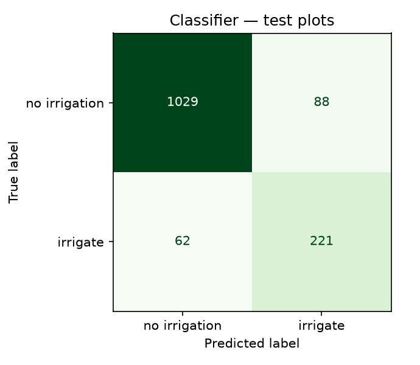
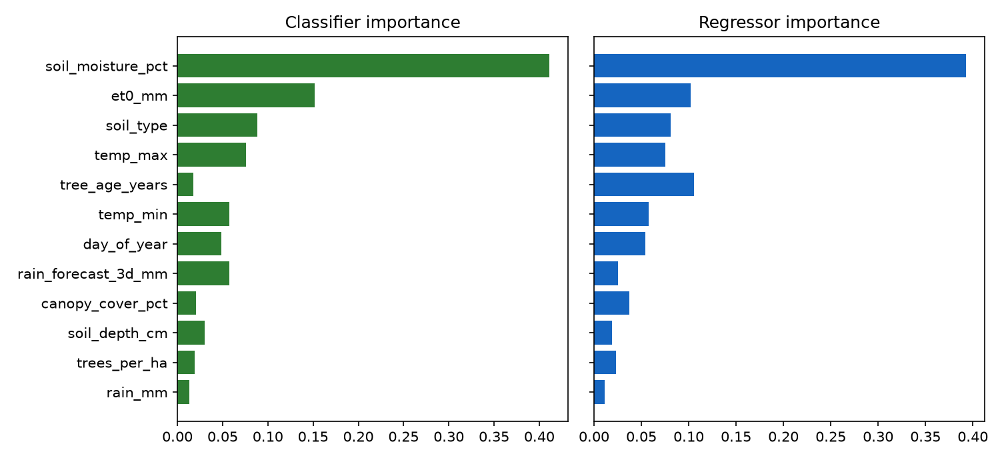

# Argan Irrigation — Machine Learning

A two-stage Random Forest prototype that answers two practical questions for an
argan plot:

1. **Should this plot be irrigated today?** (yes / no classifier)
2. **How much water does each tree need?** (litres-per-tree regressor)

Both models use only weather, soil and tree features — no hidden simulation
variables — and are trained/evaluated with a plot-level split so the reported
scores are honest.

## Project summary

- Trained a `RandomForestClassifier` for the irrigation decision and two
  `RandomForestRegressor`s for water volume (one for all days, one specialised
  for irrigation days).
- Built a leakage-free evaluation: all 50 days of a plot stay in the same
  split (`GroupShuffleSplit` on `plot_id`), so the test set contains only plots
  the model has never seen.
- Compared against trivial baselines, measured the realistic accuracy ceiling
  imposed by sensor noise, and produced confusion-matrix, ROC/PR,
  predicted-vs-actual and feature-importance reports.
- Packaged everything into a reproducible pipeline with a small CLI for scoring
  new CSV/JSON rows, plus a documented path for retraining on real field data.

## Results at a glance

Held-out test set: **28 plots / 1,400 rows** never seen during training.

| Model | Metric | Score | Baseline |
| --- | --- | --- | --- |
| Classifier — irrigate today? | accuracy | **0.893** | 0.798 (always "no") |
| | balanced accuracy | **0.851** | 0.500 |
| | precision / recall | **0.715 / 0.781** | 0 / 0 |
| | F1 | **0.747** | 0.000 |
| | ROC-AUC | **0.938** | 0.500 |
| | PR-AUC | **0.790** | 0.202 |
| Regressor A — all rows | R² | **0.442** | −0.002 (predict mean) |
| | MAE | **41.6 L** | 63.3 L |
| | median absolute error | **19.4 L** | — |
| Regressor B — irrigation days only | R² | **0.838** | — |
| | MAE | **41.4 L** | — |

Regressor B is trained only on rows where `irrigate_yes_no == 1` and is the one
to use after the classifier says "yes". On those same rows Regressor A manages
only R² 0.276 / MAE 84.8 L. Note that B is scored here on rows that *truly*
irrigate — in production the classifier also sends some false positives to it,
so real sizing error will be somewhat larger.

Confusion matrix at the default 0.5 threshold: 1,029 true negatives, 88 false
positives, 62 false negatives, 221 true positives.

| Confusion matrix | ROC and precision-recall |
| --- | --- |
|  |  |

| Predicted vs actual litres | Feature importance |
| --- | --- |
|  |  |

## Dataset

- **7,000 rows** = 140 argan plots × 50 consecutive days, using Marrakech
  weather samples from 2015–2025.
- **19.9 % of rows are irrigation days**; the litres target is zero-inflated
  (median 0, 75th percentile 0; on irrigation days mean 202 L, max 832 L).
- Labels come from a FAO-56-style water-balance simulation. The generated CSVs
  are included in `data/`; the generator script itself is **not** part of this
  repository.

| File | Contents |
| --- | --- |
| `data/argan_dataset_train.csv` | 14 features + 2 labels (training data) |
| `data/argan_dataset_full.csv` | Same rows plus `plot_id` and simulation helper columns (used only for the grouped split) |

The full file is identical row-for-row to the training file. Only `plot_id` is
used from it. The helper columns (`taw_mm`, `raw_mm`, `active_area_m2`,
`root_depth_m`, `depletion_*`, `etc_mm`, …) are **not** used as features: they
are intermediate results of the same formula that produced the label, so
training on them would mostly re-learn the generator rather than the agronomy.

### Features used

`day_of_year`, `month`, `temp_max`, `temp_min`, `rain_mm`, `et0_mm`,
`rain_forecast_3d_mm`, `argan_stage`, `tree_age_years`, `trees_per_ha`,
`canopy_cover_pct`, `soil_type`, `soil_depth_cm`, `soil_moisture_pct`.

`argan_stage` and `soil_type` are one-hot encoded inside the pipeline; unknown
categories at prediction time are ignored (all-zero encoding) instead of
crashing.

## Method

- **Split by plot, not by row.** The 50 rows of a plot share weather, soil and
  tree geometry, so a random row split leaks and inflates the scores.
  `GroupShuffleSplit` on `plot_id` (80/20) puts all rows of a plot on one side.
  For scale: on a random row split Regressor B reports R² 0.96 instead of 0.84,
  while the classifier F1 0.72 stays similar — the regression gain is almost
  entirely leakage from seeing other days of the same plot.
- **Preprocessing lives inside the scikit-learn `Pipeline`**, so the saved
  `.joblib` files accept raw dataframes with the original column names.
- **Hyperparameters** were selected with grouped 5-fold cross-validation on the
  training plots:
  - classifier: 600 trees, `max_features=1.0`, `min_samples_leaf=2`
    (CV F1 0.718 ± 0.011);
  - regressors: 600 trees, `max_features=0.66`, `min_samples_leaf=3`
    (CV R² 0.383 ± 0.17).
  A high `max_features` beats the usual `sqrt` because several of the 14
  inputs interact strongly (soil moisture × soil type × tree age × ET0).
- **Two-stage sizing.** The classifier decides whether to irrigate; Regressor B
  then sizes the event. Regressor A is kept for one-shot litres prediction.

## Why the scores are not higher

The label is computed from the **true** soil moisture, while the model only
sees the **sensor reading**, which the dataset generator perturbs with 0.2 %
(volumetric) Gaussian noise. That noise maps to several mm of root-zone water
and up to a hundred litres per tree near the irrigation trigger — exactly where
the label jumps from 0 to a full event.

Measured directly on this dataset:

| Predictor | R² | MAE |
| --- | --- | --- |
| Generator formula + noisy sensor reading | 0.50 | 20.4 L |
| Generator formula + hidden true moisture (oracle) | 0.93 | 3.4 L |

So ~0.50 R² is the realistic ceiling for *any* model limited to the 14
published features, and the test split has only 28 plots, which makes the
regression score vary by roughly ±0.17 between splits. The classifier's AUC of
0.94 is the more stable summary.

## Quick start

Requirements: Python 3.10+ (developed on 3.14).

```bash
git clone https://github.com/ilyassbaslam-hash/argan-irrigation-ml.git
cd argan-irrigation-ml

python3 -m venv .venv
source .venv/bin/activate        # Windows: .venv\Scripts\activate
pip install -r requirements.txt

python train_model.py
python predict.py --demo
```

Training takes a few seconds and creates `models/` plus refreshes `reports/`.
The trained `.joblib` files (~23 MB) are intentionally **not committed** —
they are generated artifacts and are rebuilt by the command above.

Useful training flags:

```bash
python train_model.py --no-groups      # random row split (for comparison only)
python train_model.py --no-figures     # skip the PNGs (matplotlib not needed)
python train_model.py --seed 7         # different split/forest seed
```

## Predicting

```bash
python predict.py --demo
python predict.py --csv new_plot_days.csv --out predictions.csv
python predict.py --json '{"day_of_year": 195, "month": 7, ...}'
python predict.py --mode direct --demo      # one-shot Regressor A
```

Input needs the 14 feature columns; one row = one plot on one morning. Extra
columns (such as labels) are ignored. Output columns are prefixed with `pred_`
so input labels are never overwritten:

| Column | Meaning |
| --- | --- |
| `pred_irrigate_yes_no` | classifier decision at the threshold |
| `pred_irrigate_probability` | probability of irrigation |
| `pred_irrigation_L_per_tree` | litres from the selected regressor |
| `pred_recommended_L_per_tree` | litres, forced to 0 when the decision is "no" |

From Python:

```python
import joblib
import pandas as pd

clf = joblib.load("models/irrigation_classifier.joblib")
reg = joblib.load("models/irrigation_regressor_positive_only.joblib")

row = pd.DataFrame([{...14 features...}])
p = clf["pipeline"].predict_proba(row[clf["features"]])[:, 1][0]
litres = reg["pipeline"].predict(row[reg["features"]])[0] if p >= 0.5 else 0.0
```

The bundles are dictionaries, not bare pipelines: `{"pipeline", "features",
"categorical", "target", "metrics", ...}`. `features` tells you the required
column order, and `metrics` lets the app display the model's own test scores.

## Repository layout

| Path | Purpose |
| --- | --- |
| `schema.py` | Feature/label definitions shared by training and prediction |
| `train_model.py` | Trains, evaluates, writes models + reports |
| `predict.py` | Scores new plot-days from CSV, JSON or the built-in demo |
| `data/argan_dataset_train.csv` | 14 features + 2 labels (training data) |
| `data/argan_dataset_full.csv` | Same rows + `plot_id` and helper columns (split only) |
| `reports/metrics.json` | All metrics, chosen parameters, split summary |
| `reports/feature_importance.csv` | Aggregated importances for both forests |
| `reports/figures/*.png` | Confusion matrix, ROC/PR, predicted-vs-actual, importances |
| `models/*.joblib` | Created by `train_model.py` (not committed) |

Top features (mean of both forests): `soil_moisture_pct` 40 %,
`et0_mm` 13 %, `soil_type` 8 %, `temp_max` 8 %, `tree_age_years` 6 %,
`temp_min` 6 %, `day_of_year` 5 %, `rain_forecast_3d_mm` 4 %.

## Limitations — read before using in production

- **Synthetic labels.** Every row and label comes from a FAO-56-style
  simulation. The forests learn that simulation, not measured argan behaviour.
  They are a software prototype, not agronomic advice.
- **No official argan Kc exists.** The generator used a scaled-down olive
  proxy, a simplified month-to-stage mapping, and FAO-56-style soil values.
  Those assumptions are inherited by these models.
- **Sensor noise is the dominant error** for litres (see the ceiling table).
  Improving the sensor or filtering the reading over several days would raise
  the achievable accuracy more than a bigger forest.
- **The labels are the "full need" schedule.** The scarcity allocator that cuts
  water under a limited budget is a separate layer; these models predict the
  comfortable schedule, not how to ration it.
- **Only 140 plots / 11 years.** Tree age, spacing and soil combinations are
  sampled; rare real-world combinations may fall outside the training range,
  where forests cannot extrapolate.
- **Bounded output.** Predictions never exceed the largest label seen
  (~832 L/tree) and Regressor B is only meaningful when the classifier says
  "yes"; in particular, a "no" row can still show a non-zero conditional litres
  value in `pred_irrigation_L_per_tree`.

## Retraining on real data

Keep the same column names (`schema.py`), put your file at
`data/argan_dataset_train.csv`, and run `train_model.py`. If you have a column
that identifies the field/tree (recommended), add it to the full file as
`plot_id` so the split stays grouped; otherwise use `--no-groups` and expect
optimistic scores. Re-check Kc/soil assumptions in the generator first — a
model cannot be better than its labels.

## Tech stack

Python · pandas · NumPy · scikit-learn · joblib · matplotlib
