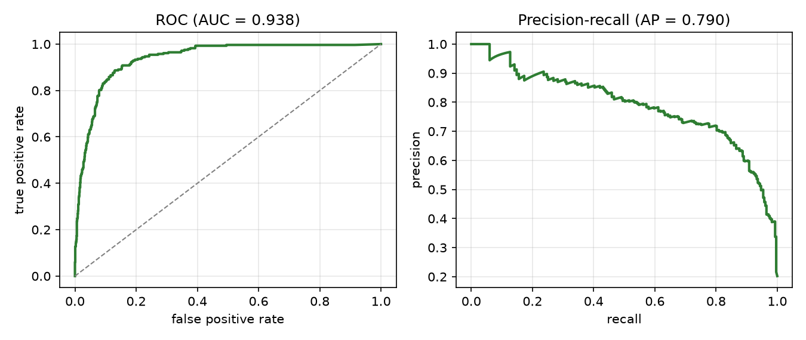
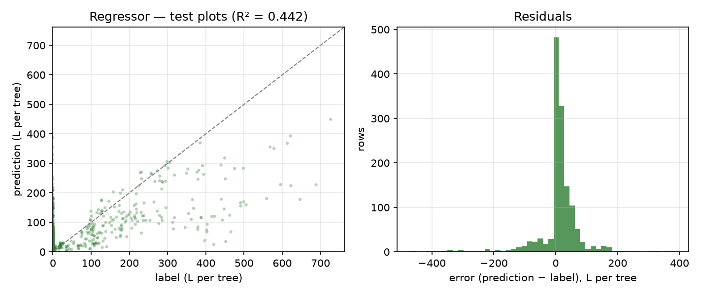

# Argan Irrigation — from water need to scarcity allocation

A prototype for an argan irrigation app that answers two different questions:

1. **What does this plot need?** A Random Forest classifier decides whether to
   irrigate, and Regressor B sizes the event in litres per tree.
2. **Given only X m³, where should the water go?** A scarcity allocator ranks
   plots and growth stages by marginal value per cubic metre, guarantees a
   survival floor, and shows the stress cost of every cut.

The second question is the product. Most irrigation tools are calculators: they
say what the crop needs in a comfortable year. A farmer in a drought often
cannot supply that. The useful question is:

> “I have 150 m³ this week, not 218 m³. How do I split it across my plots and
> growth stages so that I lose the least yield?”

That is **deficit irrigation**, and it is a different product from a water
calculator.

> **Status:** research prototype trained on a synthetic dataset. The weather is
> real and verified; the labels are a rule-based simulation. This is not yet
> field-validated agronomic advice. See
> [Dataset reliability](#9-dataset-reliability-what-is-real-and-what-is-simulated)
> before using any number in the field.

---

## Contents

1. [The product idea](#1-the-product-idea)
2. [End-to-end app workflow](#2-end-to-end-app-workflow)
3. [The machine-learning layer](#3-the-machine-learning-layer)
4. [The scarcity allocator](#4-the-scarcity-allocator)
5. [Demo: from forecast to allocation](#5-demo-from-forecast-to-allocation)
6. [Commands](#6-commands)
7. [Input formats](#7-input-formats)
8. [Model results](#8-model-results)
9. [Dataset reliability: what is real and what is simulated](#9-dataset-reliability-what-is-real-and-what-is-simulated)
10. [Limitations](#10-limitations)
11. [What would make it real](#11-what-would-make-it-real)
12. [Repository layout](#12-repository-layout)

---

## 1. The product idea

### Scarcity instead of need

An irrigation recommendation usually has one number: the crop’s water
requirement. That number is useful, but it assumes water is available. In the
real orchard, water is rationed by a canal schedule, a well yield, a pump’s
flow rate, a storage tank, or a season quota. The farmer does not choose
between “irrigate” and “do nothing”; they choose **which plots get less**.

The allocator therefore does not ask “can I meet every need?” It asks:

- What is the **full weekly need** of each plot?
- What is the **minimum floor** that keeps each plot alive and avoids
  catastrophic stress?
- If the budget cannot cover everything, which extra cubic metre buys the most
  avoided stress?
- What does the farmer give up by cutting a plot — in stress level and in a
  transparent loss score?
- How much better is this than simply cutting every plot by the same
  percentage?

The output is a plan, not a lecture. For every plot it gives litres per tree,
the days to irrigate, the pump minutes, the remaining budget, and a stress
badge. That lets the farmer see the cost of each cut and decide whether to
accept it.

### Why argan, and why the olive proxy matters

Argan (*Argania spinosa*) is endemic to Morocco and is central to the
southwestern economy. It is drought-tolerant, but “drought-tolerant” does not
mean “needs no water”: productivity, fruit set and oil yield still respond to
water, especially in dry years and on shallow soils.

There is no official FAO-56 crop coefficient (Kc) for argan. The dataset used a
scaled **olive** Kc as a proxy, plus a simplified month-to-stage mapping. Olive
is a reasonable analogue for a drought-adapted Mediterranean oil crop, but
argan is not olive and the transfer is an assumption, not a measurement. The
first target is argan; olive is the natural second crop for the same allocator
because regulated deficit irrigation is better documented there. The same
product logic transfers directly to an olive orchard with olive data; this
repository’s models are argan, using olive only as a Kc proxy. The allocator’s
stage weights follow the same regulated-deficit-irrigation logic. They must be
replaced with local argan trial data before the output can be called agronomic
advice.

### What the farmer gets

| Output | Why it matters |
| --- | --- |
| Full need and allocated litres per tree | The recommendation is in the unit the farmer applies |
| Percent of need funded | Shows how deep the cut is |
| Irrigation days and litres per event | Turns a weekly volume into an actionable schedule |
| Pump minutes | Connects water to the pump and energy cost |
| Stress level (low / medium / high) | A quick visual warning |
| Stress-loss score | A transparent, comparable cost of the cut — not a yield forecast |
| Remaining budget | Keeps the season constraint visible |
| Equal-cut comparison | Shows the value of ranking instead of spreading water evenly |

---

## 2. End-to-end app workflow

This section describes the complete product. The repository implements the
model, the weekly planner and the allocator; the app shell (weather client,
database, UI, logging and season report) is design work, not included here.

### 2.1 Setup (once)

The farmer pins the plot on a map and enters:

- location (latitude/longitude, or a nearby town/grid cell);
- plot area and tree count;
- tree age (or planting year);
- spacing / trees per hectare;
- soil type and soil depth;
- irrigation system (drip, micro-sprinkler, surface);
- water source, pump flow and application efficiency.

These values are stored as a plot profile. They change rarely, unlike the
weather and soil state.

### 2.2 Set the budget

The farmer enters the water available for the season, for example a canal
allocation, a tank volume, or “pump flow × allowed hours”. Used volume starts
at zero.

There are two budget levels, and the app must not confuse them:

- **Season budget:** the total source water available over the season.
- **Weekly envelope:** how much of that budget is released this week. It must
  respect the remaining season budget and the need to save water for later
  stages.

The prototype allocator takes the **weekly envelope** in source m³. Season
accounting is app-layer logic: after each logged event, subtract the actual
source volume from the season budget, then compute the next weekly envelope.
A simple rule is “do not spend more than the remaining budget divided by the
weeks left, unless the current stage is critical”; a real app should make this
explicit and let the farmer override it.

### 2.3 Daily data pull

The app fetches past weather and the forecast from Open-Meteo:

- rainfall, maximum/minimum temperature, reference evapotranspiration (ET0);
- a 7-day forecast for the weekly plan;
- cached history so a failed request does not silently invent weather.

The prototype’s demo uses a hand-built week. Production should store the
forecast that was available at decision time, not the weather that later
occurred. This matters because the training labels used realised rain (see
[Dataset reliability](#9-dataset-reliability-what-is-real-and-what-is-simulated)).

### 2.4 Update plot state with a water balance

There are no soil-moisture sensors in the base product, so the app estimates
the root-zone state with a simple bucket model:

```text
ETc_t     = Kc(stage_t) × ET0_t
stored_t  = clamp(stored_(t-1) + rain_t + irrigation_net_t − ETc_t, 0, TAW)
TAW       = (FC − WP) × root_depth × 1000        # mm
RAW       = p × TAW                              # mm
depletion = TAW − stored                         # mm
```

- `FC` and `WP` are volumetric field capacity and wilting point.
- `p` is the fraction of TAW that the crop can use before stress; the dataset
  used the olive value `p = 0.65`.
- `irrigation_net_t` is the water that actually reaches the root zone:
  `source_m3 × efficiency × 1000 / area_m2` in mm.
- Excess water above field capacity drains; the model does not simulate
  waterlogging.

The farmer can correct the estimate with a quick manual reading or a visual
check. The corrected value becomes the next state. This is important: a water
balance that is never corrected will drift.

The model’s `soil_moisture_pct` feature, and the allocator’s `depletion_mm` and
`raw_mm` inputs, come from this layer. The repository does not implement the
balance; `plan_week.py` expects those values to be supplied for each plot.

### 2.5 Detect the argan stage

The app assigns a stage from date and tree age, with a manual override:

| Stage | Dataset month mapping | Allocator weight | Why |
| --- | --- | --- | --- |
| `winter_rest` | Dec–Feb | 0.20 | Low demand; save water for flowering |
| `flowering` | Mar–May | 1.00 | Most sensitive; avoid water stress |
| `fruit_ripening` | Jun–Aug | 0.60 | Some controlled stress is tolerable |
| `fruit_growth` | Sep–Nov | 0.90 | High demand; yield formation |

The windows are a simplification. Argan phenology varies with site, altitude
and season. More importantly, the generator’s mapping puts `fruit_ripening`
before `fruit_growth`, which is the reverse of the usual
development-then-ripening sequence. Treat the stage feature as a synthetic
calendar label, not validated argan phenology. If the app computes stages
differently, the model must be retrained on that mapping.

### 2.6 Recommender: classifier + Regressor B

One row per plot-day goes through the saved scikit-learn pipelines:

1. the classifier returns `P(irrigate)`;
2. if the probability is at least the threshold, Regressor B predicts the
   event size in litres per tree;
3. the weekly planner takes the **first recommended event** in the 7-day
   window as the weekly target;
4. a rain gate can say “wait” even when the classifier says “yes”.

The production app deliberately uses **Regressor B only**. Regressor A is kept
as a benchmark, not as a shipped model. See
[The machine-learning layer](#3-the-machine-learning-layer).

### 2.7 Allocator

The weekly need, plot metadata and the source-water budget go into the
allocator. It funds a floor first, then ranks the remaining slices by marginal
value per source m³. The output is the per-plot plan described in
[Section 4](#4-the-scarcity-allocator).

### 2.8 Output screen

For each plot, show:

- full need and allocated litres per tree;
- percent of need funded;
- number of events, litres per event and the days to irrigate;
- pump minutes total and per event;
- stress level;
- stress-loss score;
- status (`full need`, `partial, above floor`, `floor only`, `wait for rain`,
  `emergency`, …).

At the top of the screen, show the budget, total need, total floor, allocated
volume, unspent volume, emergency flag and the equal-cut comparison.

### 2.9 Log what actually happened

The farmer taps what they actually applied: volume, duration and date. That
volume is subtracted from the season budget, added to the soil water balance,
and stored as a record. The next plan starts from the logged state, not from
the recommendation. Over time this log is also the most valuable dataset the
product can collect.

### 2.10 Re-plan

Re-run the planner weekly, or sooner when the forecast changes, the pump
breaks, or the farmer logs a different volume. A weekly plan is a rolling
decision, not a fixed schedule for the season.

### 2.11 Season report

At the end of the season, show:

- water used versus the season budget;
- water used by plot and by stage;
- how often the plan was followed and how often it was overridden;
- the number of days at each stress level;
- the comparison between the optimized plan and “cut every plot equally”;
- forecast versus actual weather, and model predictions versus logged volumes.

The equal-cut comparison is a **simulated counterfactual**, not a controlled
field trial. The prototype emits the weekly comparison; season aggregation is
app-layer work and is not implemented in this repository.

---

## 3. The machine-learning layer

### 3.1 Two-stage prediction

The production path is:

```text
14 features ──► classifier ──► P(irrigate)
                    │
                    ├── P < threshold ──► no irrigation, 0 L
                    │
                    └── P ≥ threshold ──► Regressor B ──► litres per tree
```

Why two stages instead of one regressor?

- Most days are non-irrigation days, so the litres target is zero-inflated.
  A single regressor spends its capacity learning “zero versus non-zero” and
  then sizes the event.
- The classifier is easier to evaluate and calibrate (accuracy, recall,
  ROC-AUC), and the threshold is a product decision: it can be lowered to be
  conservative about missing a dry day, or raised to save water.
- Regressor B is trained only on irrigation days, so it specialises in event
  sizing. On the held-out true irrigation rows it reaches R² 0.838 / MAE
  41.4 L, while Regressor A on the same rows reaches only R² 0.276 / MAE
  84.8 L.

Regressor A is still trained and reported because it is a useful benchmark. It
is **not** part of the production recommendation. `predict.py` in two-stage
mode loads only the classifier and Regressor B; `--mode direct` loads A for
comparison.

### 3.2 The weekly need is one event, not seven events

This is the most important aggregation detail in the prototype.

The model’s litres label is the size of an **irrigation event**: “if you
irrigate this plot today, apply roughly this many litres per tree.” It is not
daily consumption. Summing the seven daily predictions would assume the farmer
irrigates every day, and it overstates the weekly need by about a factor of
seven.

The planner therefore uses:

```text
candidates = days where classifier says yes AND Regressor B predicts > 0
weekly_need = Regressor B prediction on the first candidate day
first_day   = that day’s position in the 7-day window
```

After the event, the app updates soil moisture and re-plans. If the first
event is on day 3, the allocator schedules the event on day 3, not day 1.

This matters numerically. Before the fix, the demo’s “weekly” need was about
1,523 m³; after using the first event it was **217.9 m³**. The first number
was a seven-day irrigation-every-day fantasy, not a weekly plan.

### 3.3 Rain gate

The planner applies a simple rule:

- If the 7-day forecast rain is at least `--rain-skip-mm` (default 10 mm) and
  the plot is not already below its readily available water (`depletion_mm <=
  raw_mm`), set the need to zero and status to `wait for rain`.
- If the plot is already dry (`depletion_mm > raw_mm`), irrigate despite the
  rain, because waiting could push it into stress.
- Otherwise use the classifier and Regressor B.

This is a policy rule, not a full stochastic forecast model. A production app
should use forecast probability, soil storage, and the cost of a missed event.

### 3.4 What the models do not decide

The models do not:

- choose the farmer’s budget;
- decide which plot is more valuable;
- know the price of water, labour or fruit;
- know salinity, slope, mulch or water quality;
- replace a soil-moisture sensor or a field visit.

Those are allocator inputs or app-layer policy.

---

## 4. The scarcity allocator

`allocator.py` is the core of the product layer. It works on **source water**
(the canal or pump volume the farmer actually has), not on the net litres the
tree receives.

### 4.1 Inputs

One row per plot:

| Field | Meaning |
| --- | --- |
| `plot_id` | Stable plot identifier |
| `trees` | Number of trees in the plot |
| `stage` | `winter_rest`, `flowering`, `fruit_growth` or `fruit_ripening` |
| `tree_age_years` | Age used for the establishment weight |
| `irrigation_system` | `drip`, `micro_sprinkler` or `surface` |
| `need_L_per_tree_week` | Full net need from the classifier + Regressor B |
| `depletion_mm` | Current root-zone deficit from the app’s water balance |
| `raw_mm` | Readily available water (mm) |
| `taw_mm` | Total available water (mm) |
| `pump_flow_m3_per_h` | Optional; used for pump minutes |
| `irrigate` | Classifier + rain gate; `false` means no need this week |
| `rain_forecast_mm` | Weekly forecast rain; used for the wait status |
| `priority` | Optional farmer override, default 1.0 |
| `first_day` | First recommended event day, 1–7; set by the weekly planner |

### 4.2 Source water versus net water

The model predicts **net** litres delivered to the root zone. The farmer’s
budget is **source** water. The conversion is:

```text
need_src_tree = need_net_L_per_tree / (1000 × η)     # m³ per tree
need_src_plot = need_src_tree × trees                # m³ for the plot
```

where `η` is the application efficiency:

| System | Efficiency (assumption) | Consequence |
| --- | --- | --- |
| Drip | 0.90 | Least source water per net litre |
| Micro-sprinkler | 0.85 | Intermediate |
| Surface | 0.60 | Most source water per net litre, so it is cut earlier |

These values are planning assumptions, not measurements from the farmer’s
system. A real app should let the farmer enter a measured efficiency or a
system-specific default.

### 4.3 The survival floor

Before any optimisation, every plot receives a floor:

```text
floor_i = floor_fraction × need_src_plot_i
floor_fraction = 0.35 by default
```

The floor is a **policy** choice: it keeps every plot alive and avoids
catastrophic stress, even if the optimisation would prefer to abandon a
low-value plot. It is not a biological guarantee that 35 % of need is safe.

If the budget cannot cover all floors:

```text
alloc_i = floor_i × budget / Σ floor_i
emergency = True
```

The floors themselves are cut pro-rata, every row is flagged
`emergency: floor not fully funded`, and the stress badges rise accordingly.
This is the “not enough water to keep everyone alive comfortably” case; the app
should surface it prominently and let the farmer choose which plots to save.

### 4.4 Ranking the remaining water

After the floors, the remaining budget is allocated in thin slices. The
objective is a concave benefit curve:

```text
x = fraction of a plot’s full need that is funded, floor_fraction ≤ x ≤ 1
B(x) = 1 − (1 − x)^gamma
gamma = 2.0 by default
```

`B(x)` rises quickly for the first litres and flattens near full need. This
encodes the agronomic intuition that the first water prevents the worst stress,
while the last water mostly tops up a comfortable plot.

The value of funding a slice of plot `i` is:

```text
V_i = stage_weight(stage_i)
      × age_weight(age_i)
      × priority_i
      × (1 + stress_beta × d_i)

d_i = min(1, depletion_i / RAW_i)
stress_beta = 0.5
```

The weights are:

| Stage | Weight | Rationale |
| --- | --- | --- |
| `winter_rest` | 0.20 | Low demand; save water |
| `flowering` | 1.00 | Most sensitive; avoid stress |
| `fruit_growth` | 0.90 | Yield formation |
| `fruit_ripening` | 0.60 | Controlled stress tolerable |

The dataset’s month mapping is in [Section 2.5](#25-detect-the-argan-stage);
these weights are policy, not fitted values. Because the generator’s
fruit_ripening/fruit_growth ordering is reversed relative to normal phenology,
the weights currently apply to the generator’s labels, not necessarily to real
argan. This is a known defect, not a calibration.

| Age | Weight | Rationale |
| --- | --- | --- |
| 1–8 years | 0.80 | Establishment; lower absolute yield, but future value |
| 9–25 years | 1.00 | Productive established trees |
| 26–40 years | 1.00 | Mature trees |

The marginal value per source m³ of a slice is:

```text
MV_i(x) = V_i × gamma × (1 − x)^(gamma − 1) / need_src_tree_i
```

The derivative of `B` gives the benefit per extra fraction of need; dividing by
the source m³ needed for one tree converts it to benefit per m³. The plot’s
tree count cancels because both the benefit and the cost scale with trees.

In code, the interval from `floor_fraction` to 1.0 is divided into `slices`
(12 by default). Each slice is scored at its midpoint, all slices are sorted by
`MV` descending, and the budget is filled from the top. For a separable
concave objective with a floor constraint, this greedy procedure is optimal in
the continuous version of the stated objective; the 12-slice discretisation
makes it approximate.

A useful intuition:

- a dry flowering plot with drip gets water before a comfortable winter-rest
  plot with surface irrigation;
- the surface plot needs more source water for the same net litre, so it is
  penalised by the efficiency term;
- a high `priority` value lets the farmer protect a premium or young plot;
- the diminishing-returns curve prevents one plot from absorbing the entire
  budget just because its need is large.

### 4.5 Stress badge

The stress index is:

```text
stress_i = stage_weight(stage_i)
           × (0.7 × (1 − pct_i) + 0.3 × d_i)
```

where `pct_i` is the fraction of full need funded and `d_i` is the current
depletion ratio `min(1, depletion / RAW)`.

| Stress index | Badge |
| --- | --- |
| < 0.15 | low |
| 0.15–0.35 | medium |
| ≥ 0.35 | high |

The 70/30 split says: this week’s cut matters more than the current dryness,
but an already-dry plot is worse off than a wet plot with the same cut. The
stage weight scales the whole index, so a winter-rest plot is rarely “high”
even with a large cut.

This is a communication device, not a measured plant-water status. A real
product should calibrate it against observed wilting, fruit drop and yield.

### 4.6 Events, days and pump minutes

The allocated net litres per tree are converted into operational events:

```text
events = min(max_events, max(1, ceil(allocated_L_per_tree / event_cap_L)))
```

Defaults: `max_events = 2`, `event_cap_L = 500` litres per tree. An event
larger than the cap is split up to `max_events`; beyond that, the event stays
large rather than being split indefinitely. The event days start at the
model’s `first_day` and are spread over the rest of the 7-day window; for
example, `first_day = 5` with two events gives days 5 and 7.

Pump minutes use the source volume for the whole plot:

```text
pump_minutes_total = allocated_source_m3 / pump_flow_m3_per_h × 60
pump_minutes_per_event = pump_minutes_total / events
```

If no pump flow is supplied, the pump columns are blank. The calculation
assumes the pump runs at its rated flow; real flow varies with head, filter
clogging and simultaneous users.

### 4.7 Equal-cut comparison

The allocator reports what would happen under the simplest fair rule: cut every
plot by the same percentage.

```text
f = min(1, budget / total_need)
equal_loss_score_i = 100 × stage_weight(stage_i) × (1 − f)^gamma
```

The reported `optimized_loss_score_pct` is the tree-weighted average of the
actual per-plot loss scores; `equal_loss_score_pct` is the tree-weighted
average under the equal-cut rule. `improvement_pp` is the difference in
percentage points.

The loss score is:

```text
loss_score_i = 100 × stage_weight(stage_i) × (1 − pct_i)^gamma
```

It is a **policy score**, not measured yield loss. It says how much
stage-weighted deficit remains after the allocation, using the same concave
curve as the optimisation. It is useful for comparing two plans on the same
assumptions; it is not a prediction of kilograms or litres of oil.

The allocator also uses age, priority, current dryness and irrigation
efficiency. Those affect **where** water goes, but the reported loss score is
stage-based. The reasoning is that fractional yield loss is assumed to depend
on the stage’s sensitivity to deficit; age and priority are allocation
preferences, not fractional-loss multipliers. This is a modelling choice and
should be revisited with field data.

### 4.8 Output columns

| Column | Meaning |
| --- | --- |
| `plot` | Plot identifier |
| `stage` | Growth stage |
| `trees` | Tree count |
| `need_L/tree` | Full weekly net need from Regressor B |
| `alloc_L/tree` | Allocated net litres per tree |
| `%need` | Allocated fraction of need |
| `m3` | Allocated source volume for the plot |
| `events` | Number of irrigation events |
| `days` | Event days within the week |
| `pump_min` | Total pump minutes for the plot |
| `stress` | low / medium / high |
| `loss_score` | Heuristic stage-weighted deficit score |
| `status` | `full need`, `partial, above floor`, `floor only`, `wait for rain`, `emergency: floor not fully funded`, … |

---

## 5. Demo: from forecast to allocation

### 5.1 Standalone allocator

```bash
python allocator.py --demo --budget 300
```

The built-in demo has six plots with a total full need of **447.1 m³** and a
survival floor of **156.5 m³**. A 300 m³ budget is therefore a genuine scarcity
case:

```text
Budget: 300.0 m3 | full need: 447.1 m3 | survival floor: 156.5 m3
Allocated: 300.0 m3 (67% of need)
Unspent: 0.0 m3 | emergency floor: no
Stress-loss score (heuristic, not yield): optimized 4.0% vs equal cuts 8.8% → +4.8 pp
```

| Plot | Stage | Trees | Need L/tree | Alloc L/tree | % need | m³ | Events | Days | Pump min | Stress | Loss score | Status |
| --- | --- | ---: | ---: | ---: | ---: | ---: | ---: | --- | ---: | --- | ---: | --- |
| P01 | flowering | 120 | 600.0 | 425.7 | 71% | 56.77 | 1 | 1 | 283.8 | medium | 8.4 | partial, above floor |
| P02 | fruit_growth | 400 | 200.0 | 178.3 | 89% | 79.26 | 1 | 1 | 594.4 | medium | 1.1 | partial, above floor |
| P03 | fruit_ripening | 80 | 900.0 | 315.0 | 35% | 42.00 | 1 | 1 | 168.0 | high | 25.4 | floor only |
| P04 | winter_rest | 200 | 0.0 | 0.0 | 100% | 0.00 | 0 | — | 0.0 | low | 0.0 | wait for rain |
| P05 | flowering | 100 | 750.0 | 506.2 | 68% | 59.56 | 2 | 1,7 | 357.4 | high | 10.6 | partial, above floor |
| P06 | flowering | 350 | 180.0 | 160.5 | 89% | 62.42 | 1 | 1 | 468.1 | medium | 1.2 | partial, above floor |

Reading the table:

- **P03** is a surface-irrigated ripening plot. It is expensive in source
  water (η = 0.60) and less stage-sensitive, so it receives exactly its floor
  (35 %). Its loss score is the highest, which is the visible cost of the cut.
- **P04** is winter-rest and has 18 mm of rain forecast, so it waits.
- **P05** is flowering and already dry (84 mm depletion on 109 mm RAW), so it
  gets a large share and still shows **high** stress because it started dry.
- **P06** is young with a modest need; it gets 89 % because the budget is
  exhausted, and the remaining cut is cheap in absolute litres.

### 5.2 Emergency case

```bash
python allocator.py --demo --budget 100
```

The budget is below the 156.5 m³ floor. Every non-rain plot is cut to about
22 % of need, all are flagged `emergency: floor not fully funded`, and the
stress badges are high. The equal-cut comparison still runs, but the survival
constraint dominates. This is the screen where the app must ask the farmer to
choose which plots to save, rather than pretending the allocation is normal.

### 5.3 Full weekly planner: Regressor B → weekly need → allocator

```bash
python plan_week.py --demo --budget 150
```

The planner runs the classifier and Regressor B on 42 plot-days (six plots ×
seven days), takes the first recommended event per plot, applies the rain gate,
and feeds the result to the allocator.

```text
[models] classifier + Regressor B (positive-only), threshold 0.5
[week] 6 plots, 42 plot-days
plot          stage  max_prob  first_event_day  days_over_threshold  rain_week_mm  need_L/tree                 reason
 P01 fruit_ripening     0.999                1                    7           0.0        323.3 first event day 1 of 7
 P02 fruit_ripening     0.679                1                    7           0.0         56.7 first event day 1 of 7
 P03 fruit_ripening     0.856                1                    7           0.0        600.8 first event day 1 of 7
 P04    winter_rest     0.328             <NA>                    0          12.0          0.0  wait for rain (12 mm)
 P05      flowering     0.865                1                    7           0.0        548.9 first event day 1 of 7
 P06      flowering     0.648                1                    7           0.0         12.6 first event day 1 of 7
```

The aggregate plan:

```text
Budget: 150.0 m3 | full need: 217.9 m3 | survival floor: 76.3 m3
Allocated: 150.0 m3 (69% of need)
Unspent: 0.0 m3 | emergency floor: no
Stress-loss score (heuristic, not yield): optimized 1.8% vs equal cuts 6.6% → +4.8 pp
```

| Plot | Stage | Trees | Need L/tree | Alloc L/tree | % need | m³ | Events | Days | Pump min | Stress | Loss score | Status |
| --- | --- | ---: | ---: | ---: | ---: | ---: | ---: | --- | ---: | --- | ---: | --- |
| P01 | fruit_ripening | 120 | 323.3 | 254.7 | 79% | 33.96 | 1 | 1 | 169.8 | medium | 2.7 | partial, above floor |
| P02 | fruit_ripening | 400 | 56.7 | 53.6 | 95% | 23.83 | 1 | 1 | 178.8 | medium | 0.2 | partial, above floor |
| P03 | fruit_ripening | 80 | 600.8 | 275.4 | 46% | 36.72 | 1 | 1 | 146.9 | medium | 17.6 | partial, above floor |
| P04 | winter_rest | 200 | 0.0 | 0.0 | 100% | 0.00 | 0 | — | 0.0 | low | 0.0 | wait for rain |
| P05 | flowering | 100 | 548.9 | 430.0 | 78% | 50.58 | 1 | 1 | 303.5 | high | 4.7 | partial, above floor |
| P06 | flowering | 350 | 12.6 | 12.6 | 100% | 4.90 | 1 | 1 | 36.8 | medium | 0.0 | full need |

With a 300 m³ budget the same week is fully funded (217.9 m³, 82.1 m³
unspent), which proves the allocator does not spend water just because it is
available. The 150 m³ run is the meaningful scarcity demo.

### 5.4 What the comparison does and does not say

The +4.8 pp is the difference between the allocator’s stage-weighted deficit
score and an equal-cut plan under the same heuristic. It is **not** a measured
yield difference of 4.8 %. A field trial with yield, fruit set and oil content
is the only way to attach a real number to that comparison.

---

## 6. Commands

Requirements: Python 3.10+ (developed on 3.14). The trained model bundles are
included in `models/`, so the demos below run without training first.

```bash
git clone https://github.com/ilyassbaslam-hash/argan-irrigation-ml.git
cd argan-irrigation-ml
python3 -m venv .venv
source .venv/bin/activate          # Windows: .venv\Scripts\activate
pip install -r requirements.txt
```

### Train

```bash
python train_model.py
python train_model.py --no-groups      # random row split, for comparison only
python train_model.py --no-figures     # skip PNG reports
python train_model.py --seed 7         # different split/forest seed
```

Training writes `models/` and refreshes `reports/`. The three `.joblib` bundles
are committed, so a fresh clone can run the demos immediately; re-run training
only when the data, code or hyperparameters change.

### Predict one plot-day

```bash
python predict.py --demo
python predict.py --csv new_plot_days.csv --out predictions.csv
python predict.py --json '{"day_of_year":195,"month":7,"temp_max":38.4,"temp_min":21.0,"rain_mm":0.0,"et0_mm":6.4,"rain_forecast_3d_mm":0.0,"argan_stage":"fruit_ripening","tree_age_years":18,"trees_per_ha":204,"canopy_cover_pct":52.0,"soil_type":"sandy_loam","soil_depth_cm":80,"soil_moisture_pct":12.5}'
python predict.py --mode direct --demo   # benchmark: Regressor A
```

The default is two-stage. In that mode only
`irrigation_classifier.joblib` and
`irrigation_regressor_positive_only.joblib` are needed; a deployment directory
with just those two files works. `--mode direct` additionally needs
`irrigation_regressor.joblib`.

### Allocate a plot table

```bash
python allocator.py --demo --budget 300
python allocator.py --csv plots.csv --budget 150 --out plan.csv
```

Useful flags:

| Flag | Default | Meaning |
| --- | --- | --- |
| `--budget` | 300 for `--demo`; required for `--csv` | Weekly source water, m³ |
| `--floor-fraction` | 0.35 | Minimum share of need before any cut |
| `--gamma` | 2.0 | Curvature of the benefit curve |
| `--stress-beta` | 0.5 | Extra priority for dry plots |
| `--slices` | 12 | Discretisation of the post-floor range |
| `--max-events` | 2 | Maximum events per plot per week |
| `--out` | — | Write the plan to CSV |

### Plan a week from 7-day forecasts

```bash
python plan_week.py --demo --budget 150
python plan_week.py --csv week_forecast.csv --budget 150 --out weekly_plan.csv
```

Useful flags:

| Flag | Default | Meaning |
| --- | --- | --- |
| `--budget` | required | Weekly source water, m³ |
| `--threshold` | 0.5 | Classifier probability for “irrigate” |
| `--rain-skip-mm` | 10.0 | Weekly rain that triggers “wait” for a non-stressed plot |
| `--model-dir` | `models/` | Directory with the saved bundles |
| `--out` | — | Write the combined plan to CSV |

To export the demo week as a CSV and run it back through the file path:

```python
from plan_week import demo_week
demo_week().to_csv("week_forecast.csv", index=False)
```

```bash
python plan_week.py --csv week_forecast.csv --budget 150 --out weekly_plan.csv
```

---

## 7. Input formats

### 7.1 Allocator CSV

One row per plot. Required columns:

| Column | Type | Notes |
| --- | --- | --- |
| `plot_id` | string | Unique |
| `trees` | integer | > 0 |
| `stage` | string | One of the four stages |
| `tree_age_years` | number | Used for the age weight |
| `irrigation_system` | string | `drip`, `micro_sprinkler`, `surface` |
| `need_L_per_tree_week` | number | Net weekly need |
| `depletion_mm` | number | Current root-zone deficit |
| `raw_mm` | number | Readily available water |
| `taw_mm` | number | Total available water |

Optional columns:

| Column | Default | Notes |
| --- | --- | --- |
| `pump_flow_m3_per_h` | blank | Enables pump-minute output |
| `irrigate` | `true` | `false` zeros the need |
| `rain_forecast_mm` | 0 | Used for the `wait for rain` status |
| `priority` | 1.0 | Farmer override; must be > 0 |
| `first_day` | 1 | First event day, 1–7 |

Example row:

```csv
plot_id,trees,stage,tree_age_years,irrigation_system,need_L_per_tree_week,depletion_mm,raw_mm,taw_mm,pump_flow_m3_per_h,irrigate,rain_forecast_mm,priority,first_day
P01,120,flowering,18,drip,600,25,60,96,12,true,0,1.0,1
```

### 7.2 Weekly planner CSV

One row per **plot-day**, ideally seven rows per plot. It must contain the 14
model features plus plot metadata repeated on every row:

| Group | Columns |
| --- | --- |
| Model features | `day_of_year`, `month`, `temp_max`, `temp_min`, `rain_mm`, `et0_mm`, `rain_forecast_3d_mm`, `argan_stage`, `tree_age_years`, `trees_per_ha`, `canopy_cover_pct`, `soil_type`, `soil_depth_cm`, `soil_moisture_pct` |
| Plot metadata | `plot_id`, `trees`, `irrigation_system`, `depletion_mm`, `raw_mm`, `taw_mm` |
| Optional | `pump_flow_m3_per_h`, `priority`, `date` |

Notes:

- `rain_mm` is the **forecast** rain for that day; `rain_forecast_3d_mm` is the
  next-three-day forecast sum used as a model feature.
- `soil_moisture_pct` is the app’s current water-balance estimate (or a sensor
  reading), not the hidden simulation truth.
- `argan_stage` is the app’s stage rule, not a model output.
- If `date` is present, rows are sorted by it within each plot. If not, the
  input order is used.
- The planner warns if a plot does not have exactly seven rows; it does not
  silently pad missing days.
- `first_day` is computed by the planner from the first recommended event; it
  is not read from this file.

The full demo header (22 columns) is:

```text
plot_id, day_of_year, month, temp_max, temp_min, rain_mm, et0_mm,
rain_forecast_3d_mm, argan_stage, tree_age_years, trees_per_ha,
canopy_cover_pct, soil_type, soil_depth_cm, soil_moisture_pct,
trees, irrigation_system, pump_flow_m3_per_h, depletion_mm,
raw_mm, taw_mm, priority
```

### 7.3 Saved model bundles

Each `.joblib` file is a dictionary, not a bare pipeline:

```python
{
    "pipeline": fitted sklearn Pipeline,
    "features": [...],
    "categorical": [...],
    "target": "...",
    "metrics": {...},
    "trained_on": "..."   # for the regressors
}
```

Use `bundle["features"]` for the required column order and `bundle["metrics"]`
to display the model’s own test scores. Preprocessing (one-hot encoding and
column selection) lives inside the pipeline, so the bundle accepts a raw
dataframe with the original column names.

---

## 8. Model results

Held-out test set: **28 plots / 1,400 rows** never seen during training
(`GroupShuffleSplit` on `plot_id`).

| Model | Metric | Score | Baseline |
| --- | --- | ---: | ---: |
| Classifier — irrigate today? | accuracy | **0.893** | 0.798 (always “no”) |
| | balanced accuracy | **0.851** | 0.500 |
| | precision / recall | **0.715 / 0.781** | 0 / 0 |
| | F1 | **0.747** | 0.000 |
| | ROC-AUC | **0.938** | 0.500 |
| | PR-AUC | **0.790** | 0.202 |
| Regressor A — all rows | R² | **0.442** | −0.002 (predict mean) |
| | MAE | **41.6 L** | 63.3 L |
| | median absolute error | **19.4 L** | — |
| Regressor B — irrigation days only | R² | **0.838** | — |
| | MAE | **41.4 L** | — |
| | median absolute error | **23.4 L** | — |

Regressor B is scored on rows that **truly** irrigate. In production the
classifier also sends some false positives to it, so end-to-end sizing error
will be somewhat larger. On those same true irrigation rows, Regressor A
reaches only R² 0.276 / MAE 84.8 L, which is why B is the production model.

Confusion matrix at the default 0.5 threshold: 1,029 true negatives, 88 false
positives, 62 false negatives, 221 true positives.

| Confusion matrix | ROC and precision-recall |
| --- | --- |
|  |  |

| Predicted vs actual litres | Feature importance |
| --- | --- |
|  |  |

### Why the scores are not higher

The label is computed from the **true** soil moisture, while the model only
sees the **sensor reading**, which the dataset generator perturbs with 0.2 %
(volumetric) Gaussian noise. That noise maps to several mm of root-zone water
and up to a hundred litres per tree near the irrigation trigger — exactly where
the label jumps from 0 to a full event.

Measured directly on this dataset:

| Predictor | R² | MAE |
| --- | ---: | ---: |
| Generator formula + noisy sensor reading | 0.50 | 20.4 L |
| Generator formula + hidden true moisture (oracle) | 0.93 | 3.4 L |

So ~0.50 R² is the realistic ceiling for *any* model limited to the 14
published features, and the test split has only 28 plots, which makes the
regression score vary by roughly ±0.17 between splits. The classifier’s AUC of
0.94 is the more stable summary.

A random row split inflates Regressor B from R² 0.84 to 0.96, because the same
plot’s neighbouring days appear in both train and test. The grouped split is
the honest one.

---

## 9. Dataset reliability: what is real and what is simulated

This section is deliberately blunt. The prototype is useful, but the data is
not field evidence.

### 9.1 What is in the data

- **7,000 rows** = 140 argan plots × 50 consecutive days.
- Dates span February 2015 to December 2025.
- **No missing cells, no duplicate feature rows**, no impossible ranges.
- All 12 months are represented (537–602 rows each).
- 19.9 % of rows are irrigation days; the litres target is zero-inflated.
- On irrigation days, the event size has mean 202 L, median 164 L, 90th
  percentile 425 L and maximum 832 L per tree.
- 140 plots have 139 unique (age, soil, depth, trees-per-ha) profiles; 4 tree
  ages have only one plot, and some soil × depth cells have three plots.

### 9.2 What is genuinely good

- **Weather is real and verified.** The dataset’s source is Open-Meteo. A fresh
  Open-Meteo pull at the same point gives **268.6 mm/year** over 2015–2025;
  NASA POWER gives **268.9 mm/year**. The earlier “475 mm/year” figure was an
  artefact of summing one weather day once per active plot, not a climate
  signal. Deduplicated, the weather is credible. The sources disagree in the
  wettest year (Open-Meteo 540 mm vs NASA POWER 423 mm in 2018), so individual
  extreme years should be treated with caution.
- **Seasonality is sensible.** Irrigation share is about 9–10 % in December–
  January and 29–32 % in July–August. Only 1.6 % of rows with ≥5 mm rain are
  irrigation days, versus 21.3 % of rows with <1 mm rain.
- **The water balance is carried, not invented.** The 30-day warm-up works:
  the first recorded day has mean soil moisture 24.28 % versus 24.25 % for the
  rest, so there is no obvious initialisation artefact.
- **Event sizes scale with age.** Median event is 34 L for ages 1–8, 210 L for
  ages 9–25 and 377 L for ages 26–40.
- **The generator is self-consistent.** The stored label can be reproduced
  from the stored helper columns, and the code validates ranges and label
  consistency.

### 9.3 Where it does not represent the real world

**The labels are a rule, not observations.** There are no measured soil
moisture series, no farmer irrigation logs, no yield, no tree-health outcome.
A model with R² 0.44 (all rows) or 0.84 (irrigation rows) has learned the
generator plus sensor noise. If the Kc, trigger or root-depth assumptions are
wrong, the model is confidently wrong.

**The simulated soil never reaches water stress.** Across all 7,000 rows, the
maximum depletion is **0.698 × RAW**, only 0.1 % of rows exceed 50 % of RAW,
and none exceed 80 %. The maximum depletion is 45 % of TAW. The 15 %-of-RAW
trigger with a 4 mm floor, plus a 50–90 % farmer-compliance assumption, keeps
every plot in the wet half of the available range. Consequences:

- the `Ks` stress branch of the water balance is never exercised;
- the model has **zero examples of a dry orchard**, which is exactly the
  situation where an irrigation recommender matters most;
- “over-watered” also never happens in the true state: moisture is clamped at
  field capacity and excess drains away. The 7.8 % of sensor readings above
  field capacity are noise, not waterlogging.

**The inputs contain information a morning app would not have.** The label uses
**today’s actual rain** and the **actual rain of the next three days**; the
features include today’s actual `rain_mm`, `et0_mm` and `temp_max`. A real app
has forecasts, not the realised day. The impact is moderate, not catastrophic:

| What is removed from the label logic | Decisions flipped | Mean absolute change on flipped rows |
| --- | ---: | ---: |
| Today’s rain | 0.8 % | 9.4 mm |
| Three-day “forecast” rain | 2.5 % | 9.2 mm |
| Both | 3.8 % | 9.5 mm |

So the label is not dominated by look-ahead, but the model’s input set is still
not deployable as-is, and real forecast error will degrade performance.
`rain_forecast_3d_mm` is a perfect forecast multiplied by an arbitrary 0.5
reliability factor, not a real forecast.

**The agronomy is an olive proxy, not argan.** No FAO-56 Kc exists for argan.
The generator used a scaled olive value; the month-to-stage mapping is a
calendar convenience (winter_rest Dec–Feb, flowering Mar–May, fruit_ripening
Jun–Aug, fruit_growth Sep–Nov — the last two reverse the usual
development-then-ripening order); `p = 0.65` is the olive value; root depth is
`0.25 + 0.12 × age`, capped at 1.2 m (mean 0.8 m). Mature argan is deeply
rooted and can exploit fractures below 1.2 m, so the TAW is probably too small
and the schedule may be too frequent. Wetted area is 1.5 × canopy area; for
drip, the wetted zone is usually smaller than the canopy, not larger. The
trigger is 15 % of RAW with a 4 mm floor, a conservative “little and often”
rule; the 40 mm event cap and 100 % application efficiency are assumptions.
Real drip efficiency is roughly 85–95 %, so the dataset’s litres are **net**
requirement and must be grossed up in the app — which is exactly what the
allocator does with its efficiency table.

**Statistical power is 140, not 7,000.** The rows within a plot are 50
consecutive, correlated days. Grouped cross-validation shows the regression
score varying by **±0.17 R²** between folds. There are only 139 unique plot
profiles; some soil × depth cells have three plots. The model interpolates
between those points; it cannot be trusted in sparse corners.

**One site, one climate.** Marrakech is inland and hot; argan’s main range is
coastal southwestern Morocco (Essaouira, Agadir, Souss), with different
humidity, wind and salt exposure. The weather is real but may not be
representative of the target orchards. There is also no spatial variability:
one grid cell for every plot.

**The sensor model is optimistic and too clean.** 0.2 % iid Gaussian noise with
no bias, drift, autocorrelation or spatial variability; real capacitance
sensors are often ±1–3 %. Ironically the noise is still the dominant error:
applying the generator formula to the noisy reading gives R² 0.50, versus 0.93
with the hidden true moisture. That is realistic in spirit — sensor noise
limits learning — but the magnitude and structure are assumptions.

**Real farm data is messier.** There are no gaps, outliers, duplicates,
conflicting records or missing sensor days. No irrigation timestamps, water
meters, yields, tree health, energy cost or farmer constraints. The model has
never had to handle a broken sensor.

**No yield or economic data.** The allocator’s loss score is a heuristic. There
is no measured yield response to water, no oil price, no water price, no labour
or energy cost. The product can rank water by policy value, but it cannot yet
claim an economic optimum.

### 9.4 Scorecard

| Dimension | Verdict |
| --- | --- |
| Structural quality (NaNs, duplicates, ranges) | **Strong** |
| Weather realism | **Strong — verified against two sources** |
| Soil-water logic | **Reasonable simplification, self-consistent** |
| Argan agronomy | **Assumption-driven, not validated** |
| Farmer behaviour | **Plausible but arbitrary** |
| Statistical power | **Weak: 140 independent plots, not 7,000** |
| Represents real orchards? | **Not yet** |
| Code reliability | **Good as software; validation is self-consistency, not truth** |

### 9.5 Bottom line

As a **prototype sandbox**, the dataset is good: clean, documented,
reproducible, with real weather and sensible seasonal behaviour. As a
**representation of real-world argan irrigation**, it is not there yet: the
labels are a normative rule, the soil never gets dry, the strongest agronomic
parameters are proxies, and 140 plots cannot support claims of field accuracy.

Use it to build and benchmark the app. Label the model’s output as a
simulation-based recommendation until a season of field data calibrates it.

---

## 10. Limitations

### Model

- **Synthetic labels.** The forests learn a rule-based simulation, not measured
  argan behaviour.
- **No dry-orchard examples.** The training data never reaches severe stress,
  so the model has never learned the situation the product is designed for.
- **Look-ahead weather.** Labels use realised rain; features include today’s
  realised weather. Real forecast error will reduce performance.
- **Olive proxy.** Kc, `p`, root depth, wetted area and trigger are inherited
  assumptions.
- **Conditional Regressor B.** B is only meaningful after the classifier says
  “yes”; a “no” row can still show a non-zero conditional litres value.
- **Bounded output.** Predictions cannot exceed the largest label seen
  (~832 L/tree), and forests cannot extrapolate outside the training range.
- **Small effective sample.** 140 plots, 28 test plots, grouped CV ±0.17 R².

### Allocator

- **Policy weights, not measured yield response.** Stage, age, dryness and
  priority weights are assumptions. The loss score is not a yield forecast.
- **Stage mapping is coarse and partly counter-intuitive.** Four calendar
  stages cannot capture local phenology, variety or microclimate, and the
  generator’s fruit_ripening/fruit_growth order is reversed relative to the
  usual sequence.
- **Efficiency is a planning default.** The farmer’s real system may differ.
- **Floor is a policy.** 35 % of need is not a biological safety threshold.
- **Event splitting is operational.** The model predicts an event; the
  allocator’s split into one or two events is a scheduling convenience, not a
  second model.
- **Rain gate is binary.** It does not use forecast probability or the cost of
  a missed event.
- **No economics.** Water, energy, labour and fruit prices are absent.
- **No salinity, slope, mulch or water quality.**
- **Weekly scope.** Season budgeting and the season report are app-layer
  designs, not implemented here.

### Product and data

- **No field validation.** No measured soil moisture, irrigation logs, yield,
  tree health or farmer feedback.
- **No sensor calibration.** The base product uses a water balance, not
  sensors; a sensor option would need drift and bias handling.
- **One climate, one grid cell.** Marrakech weather may not represent coastal
  argan orchards.
- **No real farm messiness.** Gaps, outliers, broken sensors and conflicting
  records are not represented.
- **Not advice.** The output is decision support for a prototype, not a
  guarantee of yield, survival or water savings.

---

## 11. What would make it real

1. **Field calibration.** Five to ten plots for one season with soil-moisture
   sensors and irrigation logs. Even a small real dataset beats a large
   simulated one for credibility.
2. **Fix the information set.** Use archived forecasts (or a forecast-error
   model) for today’s rain/ET0 and the three-day rain; never feed realised
   future weather.
3. **Replace the olive proxies.** Use argan-specific Kc, phenology and rooting
   values from literature and local trials, then run a sensitivity analysis
   over Kc, `p`, root depth and trigger. If recommendations swing wildly, the
   current precision is illusory.
4. **Add a dry regime.** Lower compliance, longer dry spells, rainfed plots and
   initial states below RAW so the stress branch and recovery are represented.
5. **Grow the effective sample.** Hundreds of plots across sites and years,
   plus a time-based holdout (train on past years, test on future years).
6. **Measure yield response.** Fruit set, yield, oil content and tree health
   under different deficit levels. Without this, the loss score remains a
   policy score.
7. **Add economics.** Water price, pump energy, labour and fruit price, so the
   allocator can optimize profit rather than a stress index.
8. **Add salinity, slope, mulch, water quality and system efficiency tests.**
9. **Calibrate the sensor and the water balance.** Filter the reading over
   several days, estimate bias and drift, and let the farmer correct the state.
10. **Validate the allocator with farmers.** The weights encode preferences;
    farmers may care more about a young plot, a premium block, or next year’s
    canopy than the current score assumes.

---

## 12. Repository layout

| Path | Purpose |
| --- | --- |
| `schema.py` | Feature/label definitions shared by training and prediction |
| `train_model.py` | Trains, evaluates, writes models + reports |
| `predict.py` | Scores new plot-days from CSV, JSON or the built-in demo |
| `allocator.py` | Scarcity allocator: floor, greedy ranking, stress, pump minutes, equal-cut comparison |
| `plan_week.py` | Weekly bridge: classifier + Regressor B → weekly need → allocator |
| `data/argan_dataset_train.csv` | 14 features + 2 labels (training data) |
| `data/argan_dataset_full.csv` | Same rows + `plot_id` and helper columns (split only) |
| `reports/metrics.json` | All metrics, chosen parameters, split summary |
| `reports/feature_importance.csv` | Aggregated importances for both forests |
| `reports/figures/*.png` | Confusion matrix, ROC/PR, predicted-vs-actual, importances |
| `models/*.joblib` | Trained bundles (included; regenerate with `train_model.py`) |

### What this repository implements

| Piece | Status |
| --- | --- |
| Classifier + Regressor B training and evaluation | Implemented |
| Regressor A benchmark | Implemented, not used in production |
| One-row prediction CLI | Implemented |
| Weekly aggregation (first event) | Implemented |
| Rain gate | Implemented |
| Scarcity allocator | Implemented |
| Allocator CSV input/output | Implemented |
| Weekly planner CSV input/output | Implemented |
| Open-Meteo client | Design only |
| Soil water balance | Design only |
| Stage detection rules | Design only (stage is an input column) |
| Mobile/desktop UI | Design only |
| Farmer logging and season accounting | Design only |
| Season report | Design only (weekly comparison implemented) |

Top features (mean of both forests): `soil_moisture_pct` 40 %, `et0_mm` 13 %,
`soil_type` 8 %, `temp_max` 8 %, `tree_age_years` 6 %, `temp_min` 6 %,
`day_of_year` 5 %, `rain_forecast_3d_mm` 4 %.

---

## Tech stack

Python · pandas · NumPy · scikit-learn · joblib · matplotlib
